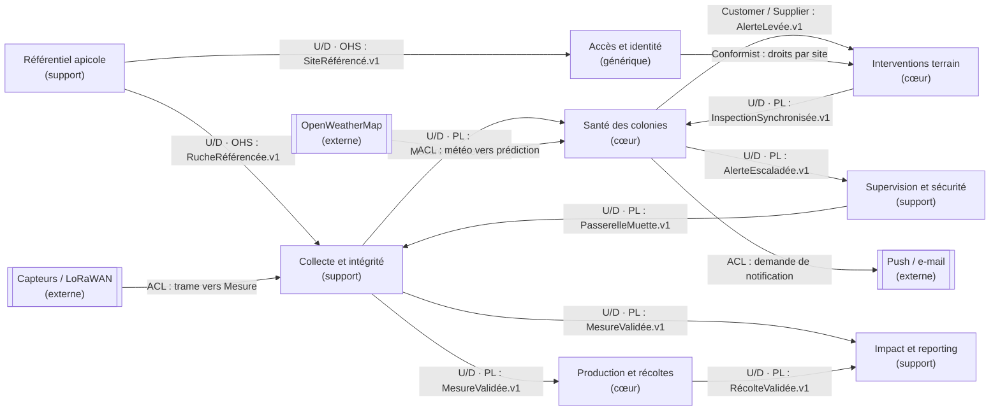

# Context map — QueenBee

8 bounded contexts, 14 relations typées (dont systèmes externes et ACL). Les flèches indiquent la direction de la dépendance ou du flux ; les relations OHS/PL signalent un langage publié à stabiliser.

## Relations et décisions

- **OHS / PL** : contrats d’événements versionnés ; le producteur ne dépend pas des consommateurs.
- **Customer / Supplier** : les interventions expriment leurs besoins au contexte Santé pour la priorisation des visites.
- **ACL** : traduction obligatoire des trames LoRaWAN et des données météo externes.
- **Conformist** : Interventions applique les droits du contexte Accès et identité sans redéfinir les rôles.
- Les relations proposées seront validées en atelier, notamment le traitement d’`AlerteEscaladée` par Supervision et Interventions.
