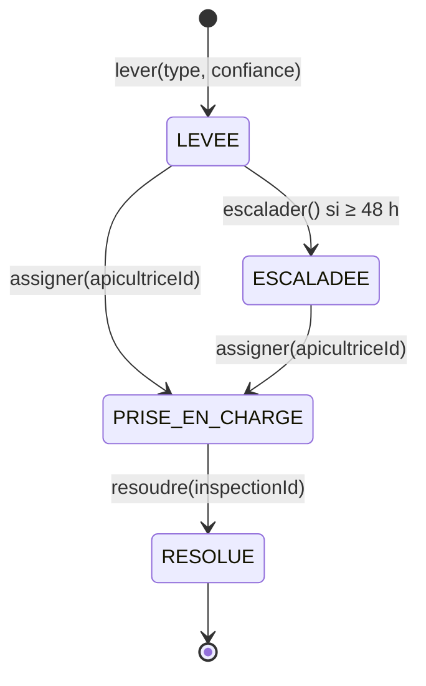

# Parcours DEV — Agrégat Alerte (QueenBee)

**Binôme :** Lokmane Salakdji et MAMAH DJEDJE Faryd  
**Contexte propriétaire :** Santé des colonies (cœur).  
**Cas d’utilisation :** UC-A02, UC-A01 et UC-C01.

## Diagramme d’états (pattern State)

Les états réels dans le code sont `LEVÉE`, `PRISE_EN_CHARGE`, `ESCALADÉE`, `RÉSOLUE`. Les noms ASCII du diagramme évitent les problèmes de syntaxe Mermaid. L’agrégat délègue les transitions aux objets `Levee`, `PriseEnCharge`, `Escaladee` et `Resolue` ; **aucun `switch` sur le statut**.

## Invariants

1. `type` appartient à `TYPES_DE_RISQUE` (`ESSAIMAGE`, `AFFAIBLISSEMENT`, `STRESS_THERMIQUE`, `MORTALITE`).
2. `confiance` est un nombre fini compris entre 0 et 1 inclus.
3. Une alerte `LEVÉE` ne peut être résolue sans prise en charge.
4. Une alerte ne peut être escaladée que si elle est toujours `LEVÉE` au moins 48 h après sa création.
5. Une alerte `ESCALADÉE` doit être prise en charge avant d’être résolue.
6. Une alerte `PRISE_EN_CHARGE` ne peut être assignée une deuxième fois ni escaladée.
7. Une alerte `RÉSOLUE` n’accepte plus aucune transition.
8. Résoudre une alerte exige un identifiant d’inspection non vide.
9. Chaque transition autorisée modifie l’état et produit **exactement un événement métier** ; `pullEvents()` les consomme une fois.

## Événements publiés et consommateurs

| Événement | Producteur | Consommateur envisagé | Déclencheur |
|---|---|---|---|
| `AlerteLevée` | Santé des colonies | Interventions terrain, notification | Risque identifié par le modèle |
| `AlertePriseEnCharge` | Santé des colonies | Interventions terrain, suivi | Apicultrice assignée |
| `AlerteEscaladée` | Santé des colonies | Coordinateur via notification ; Supervision pour suivi | Absence de prise en charge pendant 48 h |
| `AlerteRésolue` | Santé des colonies | Interventions terrain, Impact | Inspection enregistrée et résolution |

Le contexte **Santé des colonies** est propriétaire de l’agrégat. L’EventBus est appelé par le service applicatif après sauvegarde, sans dépendance du domaine envers l’infrastructure (Observer / publication d’événements).

## Fichiers et tests officiels

- `seance5-comportement-ddd/queenbee-alerte/domain/Alerte.js` : TODO 1 à 7 complétés.
- `application/AlerteService.js`, `adapters/InMemoryAlerteRepository.js`, `alerte.spec.js` : fichiers fournis conservés.
- `npm run tp5` : **12/12 tests verts**.
- `npm run lint:archi` : **règle de dépendance respectée**.
- `node seance5-comportement-ddd/queenbee-alerte/demo.js` : scénario des deux ruches exécuté.

## Préparation ADR de la séance 6

**Question :** Où placer la politique d’escalade à 48 h ?

- **Option A — tâche planifiée** : simple et observable, mais latence selon la fréquence d’exécution.
- **Option B — file différée** : déclenchement précis, mais nécessite un système de messages fiable.
- **Option C — contrôle au prochain accès** : simple, mais incompatible avec une escalade automatique garantie.

**Décision non prise :** à discuter avec BeeAfrica, notamment les garanties de délai et la connectivité intermittente. Une tâche planifiée idempotente semble une option de départ, à valider dans un ADR.

## Extensions facultatives

L’état `ANNULÉE` et un observateur dédié aux notifications du coordinateur sont des **extensions proposées, non implémentées** : elles ne sont pas nécessaires aux 12 tests officiels.
